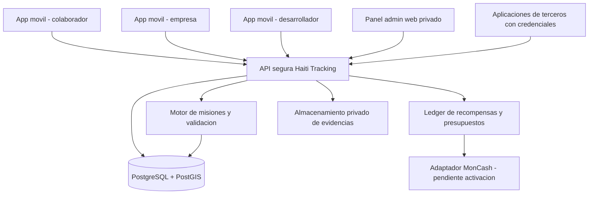
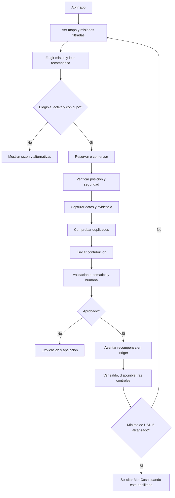

# HAITI TRACKING BY NEXOVAX

**Documento maestro de producto, pantallas, misiones, recompensas y arquitectura**  
**Versión:** 1.0 | **Fecha:** 19 de noviembre de 2026 | **Estado:** Especificación para desarrollo; pendiente de validación comercial, legal y técnica.

> **Decisión principal confirmada:** Haiti Tracking será una **aplicación para teléfonos** con tres perfiles de negocio: **colaborador, empresa y desarrollador**. La única interfaz web del producto será un **panel administrativo privado**. Se descarta el sitio web público funcional que se había planteado antes. La API y los servicios del servidor seguirán existiendo para conectar las aplicaciones y a los clientes integrados.

## 0. Resumen ejecutivo y decisiones

Haiti Tracking busca construir una base geoespacial útil y verificable de direcciones, negocios y puntos de interés de Haití a través de **misiones remuneradas en un mapa**. La experiencia principal comienza cuando un colaborador abre la app, encuentra una misión, revisa sus condiciones, visita o valida un lugar, aporta evidencia y recibe la recompensa **solo después de una aprobación de calidad**. Empresas y desarrolladores usan la misma app con módulos y permisos diferentes para consultar, administrar y consumir datos geográficos autorizados.

| Área | Definición actual | Condición |
|:---|:---|:---|
| Canal principal | Una aplicación móvil con experiencias por perfil | Confirmado por el propietario del proyecto |
| Portal web | Solo administración interna protegida | Confirmado |
| Motor del producto | Misiones geográficas sobre el mapa | Confirmado |
| Cuenta personal | Colaborador / ciudadano, de uso gratuito | Confirmado conceptualmente |
| Cuenta empresarial | Consulta, perfiles de establecimientos y solicitudes de cobertura | Diseño propuesto |
| Cuenta desarrollador | Proyectos API, credenciales, cuotas y consumo | Diseño propuesto |
| Lanzamiento móvil | Android primero, posible iOS posterior | Propuesta; confirmar plataforma |
| Mapa y datos | PostgreSQL/PostGIS; cartografia sujeta a licencia | Propuesta técnica |
| Pago de recompensas | MonCash, una vez aprobado contrato y controles | Metodo elegido, no activo |
| Retiro | Entre USD 5 y USD 50 por solicitud | Parametros previos del proyecto |
| Edad para cobrar | 18 años o más y cuenta verificada | Parametro previo |
| Costos de retiro | Comisiones del proveedor a cargo del colaborador | Parametro previo, se deben mostrar |

### 0.1. Dentro y fuera de alcance

**Dentro:** registro móvil, seleccion de perfil, mapa de misiones, captura GPS y evidencias, deteccion de duplicados, moderacion, libro mayor de recompensas, retiradas condicionadas, panel administrativo, acceso empresarial, consumo de API y privacidad de ubicaciones.

**Fuera del MVP:** página web pública de búsqueda de lugares; portal público de desarrolladores en navegador; red social; billetera transferible entre personas; promesa de ingresos fijos; navegacion giro a giro desarrollada desde cero; rutas obligatorias a zonas peligrosas; transferencias MonCash en producción sin aprobación comercial y legal.

### 0.2. Objetivos de calidad del producto

1. Que una persona vea la recompensa y los requisitos **antes de iniciar** cada misión.
2. Que las recompensas por aportes utiles puedan acercar al usuario al mínimo de retiro sin miles de tareas.
3. Que una misma dirección no se pague repetidamente como nueva por errores o fraude.
4. Que los datos de residencias privadas nunca pasen automáticamente al catálogo público.
5. Que el administrador pueda pausar una misión, presupuesto o proceso financiero en segundos.
6. Que el sistema sea útil con conectividad limitada; el borrador puede almacenarse sin conexión, pero la aprobación y el dinero dependen del servidor.
7. Que las empresas y desarrolladores consuman solo los datos para los que esten autorizados.

---

# 1. Arquitectura funcional: un producto, cuatro experiencias

| Experiencia | Canal | Propósito y permisos principales |
|:---|:---|:---|
| Colaborador | App móvil | Descubrir misiones, registrar/verificar puntos, consultar aportes y solicitar retiros |
| Empresa | Misma app móvil | Buscar puntos comerciales, gestionar sus lugares, pedir misiones y revisar reportes agregados |
| Desarrollador | Misma app móvil | Consultar documentación API, gestionar proyectos/credenciales y monitorizar cuotas y facturas |
| Administrador | Web privada `/admin` | Publicar misiones, moderar, gestionar usuarios, presupuestos, recompensas, pagos, API y auditoría |

**Regla de identidad:** una persona puede tener una sola identidad de acceso y varios roles autorizados, pero debe entrar a un **contexto de perfil** explicito. Cambiar de contexto no eleva permisos. La capacidad de gestionar una empresa requiere verificación de representacion; el acceso de desarrollador requiere proyecto habilitado. Los privilegios se verifican **siempre en el servidor**, no mediante botones ocultos.

**Regla de navegacion:** la app no contiene una seccion web pública incrustada que sustituya el sitio descartado. Los enlaces compartidos pueden abrir la app mediante deep links; si la app no está instalada, pueden llevar a la tienda, sin necesidad de implementar un buscador público web.

### 1.1. Modelo de alto nivel



*Este es el objetivo arquitectonico, no una declaracion de servicios ya desarrollados.*

---

# 2. Inventario de pantallas de la aplicación móvil

Cada pantalla incluye su propósito y las decisiones que debe permitir. Los códigos son IDs de diseño para backlog, pruebas y rutas de navegacion.

## 2.1. Pantallas compartidas (todos los perfiles)

| ID | Pantalla | Que ve y que puede hacer |
|:---|:---|:---|
| G-01 | Inicio y comprobacion de sesión | Marca, idioma, estado de red, versión y redireccion a perfil vigente |
| G-02 | Registro e inicio de sesión | Correo/teléfono y metodo de autenticación elegido; recuperación de acceso |
| G-03 | Elegir tipo de cuenta | Colaborador, empresa o desarrollador; explica funciones y requisitos |
| G-04 | Incorporacion y consentimiento | Acepta textos legales versionados y ve privacidad y uso responsable del GPS |
| G-05 | Selector de contexto | Cambia entre roles ya autorizados sin cerrar sesión |
| G-06 | Centro de notificaciones | Misiones, revisiones, pagos, alertas de seguridad y facturacion segun rol |
| G-07 | Perfil y seguridad | Nombre, idioma, sesiones activas, MFA cuando aplique y cierre de cuenta |
| G-08 | Ayuda y soporte | FAQ, ticket, estado de caso y apelaciones |
| G-09 | Idioma y accesibilidad | Criollo haitiano como prioridad; frances y otros idiomas por fases; ahorro de datos |
| G-10 | Privacidad y documentos | Consentimientos, política vigente, solicitudes sobre datos personales |
| G-11 | Estado sin conexión | Borradores sincronizables y aviso claro de operaciones no disponibles offline |

## 2.2. Perfil colaborador: pantallas C-01 a C-15

| ID | Pantalla | Contenido y acciones clave |
|:---|:---|:---|
| C-01 | Inicio del colaborador | Saludo, misiones cercanas, saldo disponible, pendientes, avisos y acceso rápido al mapa |
| C-02 | Mapa de misiones | Marcadores o zonas, filtros por tipo, recompensa y distancia, lista alternativa |
| C-03 | Lista de misiones | Tarjetas con pago, dificultad, requisitos, vigencia, cupos y tiempo estimado |
| C-04 | Detalle de misión | Objetivo, área, tareas, recompensa base/bono, evidencias, condiciones y seguridad |
| C-05 | Reservar o iniciar misión | Comprueba elegibilidad y cupos; registra asignación y vencimiento si corresponde |
| C-06 | Confirmar presencia GPS | Captura latitud/longitud, precisión, fecha y confirmacion del punto en mapa |
| C-07 | Formulario de aporte | Categoria, nombre, jerarquía territorial, referencias, acceso y campos de la misión |
| C-08 | Evidencias | Fotos, comentario y metadatos permitidos; vista previa y reglas de privacidad |
| C-09 | Posibles duplicados | Lista coincidencias, posibilidad de corregir un lugar existente o solicitar revisión |
| C-10 | Revision antes de enviar | Resumen del aporte, recompensa potencial y aviso de validación posterior |
| C-11 | Mis aportes | Pestañas borrador/enviado/en revisión/aprobado/rechazado/con apelacion |
| C-12 | Mis ganancias | Pendiente, disponible, retenido, historial inmutable y avance hasta USD 5 |
| C-13 | Retirar con MonCash | Cuenta verificada, monto USD 5-50, cotización HTG, impuestos y comisiones; condicionado a activacion |
| C-14 | Historial de pagos | Solicitudes, estados, referencias de proveedor, comprobantes y reclamaciones |
| C-15 | Calidad y reputacion | Aportes aceptados, rechazos explicados, nivel de confianza y misiones habilitadas |

**Barra inferior sugerida para colaborador:** Inicio / Mapa / Misiones / Ganancias / Perfil. El boton de crear aporte aparece dentro de una misión o de un flujo autorizado.

## 2.3. Perfil empresa: pantallas E-01 a E-10

| ID | Pantalla | Contenido y acciones clave |
|:---|:---|:---|
| E-01 | Inicio empresarial | Resumen de establecimientos, cobertura, solicitudes, plan y notificaciones |
| E-02 | Verificacion de empresa | Datos mercantiles, contacto, representante y estado de aprobación |
| E-03 | Mapa y búsqueda | Lugares públicos autorizados, búsqueda por código y filtros de sector |
| E-04 | Mis establecimientos | Listado de ubicaciones reclamadas o registradas por la empresa |
| E-05 | Reclamar o corregir ficha | Solicita titularidad, cambios de horario/dirección y evidencias de representacion |
| E-06 | Solicitar misión/campana | Define zona, objetivo, número de lugares y presupuesto tentativo; no pública directamente |
| E-07 | Estado de solicitudes | Presupuesto solicitado, aprobación, tareas completadas y resultados agregados |
| E-08 | Plan y facturas | Suscripcion, uso, facturas y estado de cobro por canales admitidos |
| E-09 | Exportaciones permitidas | Descargas de registros autorizados con límites y trazabilidad |
| E-10 | Equipo empresarial | Miembros, permisos para gestionar la organizacion y revocacion de accesos |

**Regla comercial:** una empresa puede proponer una campaña remunerada; solo el equipo administrativo puede aprobarla, financiarla y publicarla. No recibe fotos privadas de colaboradores ni coordenadas residenciales protegidas.

## 2.4. Perfil desarrollador: pantallas D-01 a D-10

| ID | Pantalla | Contenido y acciones clave |
|:---|:---|:---|
| D-01 | Inicio desarrollador | Proyectos activos, consumo, cuota y estado de servicio |
| D-02 | Nuevo proyecto API | Nombre de aplicación, entorno, uso previsto y aceptación de terminos API |
| D-03 | Credenciales y scopes | Crear/rotar/revocar claves; secreto visible una sola vez y nunca guardado en claro |
| D-04 | Explorador de endpoints | Consulta de lugares, detalle por código, proximidad, geocodificacion autorizada |
| D-05 | Ejemplos de integración | Peticiones y respuestas; recordatorio de mantener secretos en backend propio |
| D-06 | Consumo y analítica | Solicitudes por día, latencia, errores y proyeccion de cuota |
| D-07 | Limites y alertas | Rate limits, umbral de uso, bloqueos y notificaciones |
| D-08 | Planes y facturacion | Nivel de uso, cambio de plan, historial de facturas |
| D-09 | Registro de cambios API | Versiones, nuevas capacidades, deprecaciones y mantenimiento |
| D-10 | Soporte técnico | Tickets de integración, incidentes y solicitudes de acceso |

**Seguridad:** el teléfono administra credenciales, pero el cliente que consume la API debe guardar los secretos en su **servidor**, no incrustarlos en una app distribuida. Los endpoints solo entregan datos expresamente publicables.

---

# 3. Como vive el colaborador una misión en el mapa



### 3.1. Reglas de experiencia

- **No ocultar condiciones:** mostrar monto posible, tareas requeridas, fecha de cierre, cupos, criterios de rechazo, tiempo aproximado y restricciones de seguridad antes de aceptar.
- **Mapa + lista:** el mapa es el acceso principal, pero la lista accesible permite participar con conexiones lentas o dispositivos básicos.
- **Permiso contextual:** pedir GPS preciso solo al comenzar una tarea presencial; consultar misiones no exige concederlo.
- **GPS no es prueba concluyente:** guardar precisión y variacion; si es baja, pedir nueva lectura o revisión, no acusar fraude automáticamente.
- **Ubicación presencial vs propuesta remota:** las tareas remuneradas de campo exigen evidencia de presencia cuando el tipo de misión lo indique; una sugerencia remota puede quedar sin recompensa hasta corroboracion.
- **Privacidad por defecto:** evitar domicilios de particulares; si una misión requiere datos residenciales, detenerla hasta que exista base legal, consentimiento y acceso restringido.
- **Trabajo sin conexión:** permitir borradores cifrados y subida posterior con marcas de tiempo; las reservas/bonos y su validez se revalidan en servidor.
- **Seguridad física:** ninguna misión debe exigir fotografiar personas sin permiso, ingresar a predios privados, actuar de noche o transitar una zona de riesgo.

### 3.2. Ejemplo completo, con datos inventados

**Misión:** "Documenta cinco comercios públicos no registrados en una zona autorizada de Delmas".  
**Pasos:** aceptar cupo -> visitar los comercios -> registrar cinco lugares distintos con GPS y datos requeridos -> adjuntar evidencias permitidas -> obtener aprobación de los cinco registros.  
**Pago del ejemplo:** 5 x USD 0.25 por ubicación comun + **bono adicional de USD 1.00** si la misión pública ese bono y se cumplen todas las condiciones = **USD 2.25**.  
**Advertencia:** la recompensa por zona prioritaria seria de USD 0.50 **en sustitucion** de los USD 0.25 normales, no aditiva. El bono de misión no se devenga si no figura expresamente en sus condiciones.

El usuario ve por separado **potencial**, **en revisión**, **aprobado** y **disponible para retiro**. No se promete un ingreso ni se anticipa el dinero por una foto enviada.

---

# 4. Objeto de negocio MISION: definición, tipos y estados

Una **misión** es una oferta de trabajo geográfico acotado por territorio, plazo, evidencia, cupo y presupuesto. No equivale a una ubicación. Una misión puede contener varias **tareas**, y una tarea puede producir una **contribución** que modifica o verifica un **lugar** después de aprobarse.

## 4.1. Tipos iniciales

| Tipo | Resultado esperado | Recompensa piloto sugerida |
|:---|:---|:---|
| `NEW_PLACE` | Nuevo lugar público útil, aprobado y no duplicado | USD 0.25 |
| `PRIORITY_PLACE` | Nuevo lugar aprobado dentro de zona prioritaria predefinida | USD 0.50 (sustituye tarifa normal) |
| `MAJOR_CORRECTION` | Corrección importante de lugar existente, validada | USD 0.10 |
| `INDEPENDENT_CHECK` | Confirmacion independiente sin conflicto de interés | USD 0.05 |
| `BATCH_ZONE` | Meta de varios aportes validos en un área | Tarifa individual aplicable + bono configurable (ejemplo USD 1.00) |
| `WELCOME_QUALIFIER` | Primeros 5 aportes aprobados y controles superados | Bono único USD 0.50 |

**Nota:** la tarifa de bienvenida es promocional y requiere controles contra multicuentas. No toda misión genera un bono de lote. Una misma evidencia no debe remunerarse dos veces para cumplir el mismo objetivo.

## 4.2. Datos obligatorios de una misión

- **Identidad:** `mission_id`, código legible, titulo y descripción multilingue.
- **Objetivo:** tipo, categorías elegibles, número de tareas validas y formato de resultado.
- **Geografia:** departamento/comuna, poligono PostGIS o punto/radio, reglas de presencia y zonas excluidas.
- **Tiempo:** fecha de inicio, fin, ventana de reserva, fecha límite de envío y revisión.
- **Elegibilidad:** 18+ para incentivos, cuenta activa, nivel de confianza, requisitos de representacion si aplica.
- **Evidencias:** campos obligatorios, reglas de foto, posición, precisión y protección de terceros.
- **Pago:** versión de tarifa, cantidad base por tipo, bono, condición de desembolso y moneda contable USD.
- **Presupuesto:** fondos autorizados, exposición maxima, cupos, reservas y reglas al agotarse.
- **Calidad:** duplicados, mínimo de datos, corroboracion independiente y motivos de rechazo codificados.
- **Seguridad:** evaluación territorial y prohibiciones; boton para reportar zona insegura.
- **Gobernanza:** creador, aprobadores, versiones, fecha de publicación y bitacora.

## 4.3. Estados y transiciones

**Misión:** `DRAFT -> IN_REVIEW -> APPROVED -> SCHEDULED -> ACTIVE -> COMPLETED/EXPIRED -> ARCHIVED`. Desde `SCHEDULED` o `ACTIVE` se permite `PAUSED` por seguridad, presupuesto o calidad. `CANCELLED` exige motivo y respeto a trabajos elegibles ya adquiridos segun reglas vigentes.

**Asignacion a colaborador:** `CLAIMED -> IN_PROGRESS -> SUBMITTED -> ACCEPTED/REJECTED/NEEDS_CHANGES`; también `EXPIRED` o `CANCELLED`. Una misión sin reserva puede permitir envío directo si el administrador lo configura.

**Contribución:** `DRAFT -> SUBMITTED -> AUTO_CHECKED -> HUMAN_REVIEW -> APPROVED/REJECTED/NEEDS_CHANGES`. Un rechazo puede pasar a `APPEALED`, resolverse y conservar el historial.

**Recompensa:** `POTENTIAL -> PENDING_REVIEW -> EARNED -> AVAILABLE -> WITHDRAWAL_REQUESTED -> PAID`. Ante sospecha verificable, `ON_HOLD` con motivo, fecha y revisión. No modificar saldos con operaciones destructivas: realizar asientos correctivos.

### 4.4. Reglas de publicación y presupuesto

- Toda misión pasa control de calidad y presupuesto antes de hacerse visible.
- Las que manejen dinero requieren **aprobación de una persona diferente de quien la creó**; los cambios de tarifa y pago usan permisos separados.
- El costo máximo debe contemplar tarifa normal o prioritaria, bonos, cupos elegibles y costos operativos presupuestados.
- No mostrar cupos nuevos si el presupuesto remanente no cubre la exposición maxima comprometida.
- Definir si una reserva aparta cupo y presupuesto; limitar el tiempo de reserva para evitar bloqueo por cuentas inactivas.
- Mantener la tarifa versionada al momento de aceptar la misión; no reducir retroactivamente pagos por trabajo legitimo realizado bajo reglas anteriores.
- Una misión cancelada conserva trazabilidad y un mecanismo de resolucion de aportes ya enviados.

### 4.5. Ejemplo de objeto de misión (esquema ilustrativo, no endpoint en producción)

```json
{
  "code": "MIS-DEL-0001",
  "type": "BATCH_ZONE",
  "title": "Documentar cinco comercios publicos",
  "geofence_id": "zone-delmas-pilot-01",
  "required_approved_contributions": 5,
  "individual_reward": {"currency": "USD", "amount": "0.25"},
  "completion_bonus": {"currency": "USD", "amount": "1.00"},
  "max_participants": 30,
  "budget_authorized_usd": "75.00",
  "budget_max_theoretical_usd": "67.50",
  "requires_on_site_evidence": true,
  "start_at": "2026-12-01T12:00:00Z",
  "end_at": "2026-12-31T23:59:59Z",
  "status": "DRAFT"
}
```

El máximo teorico mostrado supone 30 participantes que cumplen cinco tareas comunes de USD 0.25 y reciben USD 1.00: `30 x (5 x 0.25 + 1.00) = USD 67.50`. No es un presupuesto universal ni garantiza que existan suficientes lugares no duplicados.

---

# 5. Motor de recompensas y retiradas

## 5.1. Tarifario inicial para piloto (editable desde administración)

| Evento aprobado | USD | Condición de acreditación |
|:---|---:|:---|
| Lugar nuevo comun | 0.25 | No duplicado, suficientemente documentado y aprobado |
| Lugar nuevo prioritario | 0.50 | Geografia y reglas prioritarias; sustituye 0.25 |
| Corrección importante | 0.10 | Cambio material validado, no edicion cosmetica |
| Verificacion independiente | 0.05 | Aporte verificable, no autoprobacion ni colusión |
| Bono misión especial | 1.00 | Solo si se define explicitamente y se completa la meta |
| Bono primera actividad | 0.50 | Único, después de cinco aportes aprobados y control antifraude |

**Este tarifario es una hipotesis piloto propuesta en conversaciones anteriores, no una orden para activar pagos.** Debe calibrarse con duración real del trabajo, valor de los datos, tasa de fraude, presupuesto y condiciones laborales/fiscales.

## 5.2. Calculadora de expectativas

- 20 lugares nuevos comunes aprobados: `20 x 0.25 = USD 5.00`.
- 10 lugares prioritarios aprobados: `10 x 0.50 = USD 5.00`.
- Una misión de cinco lugares normales con bono de USD 1.00: `5 x 0.25 + 1.00 = USD 2.25`.
- Dos misiones equivalentes: `USD 4.50`; tres: `USD 6.75`, siempre que sus tareas sean validas, distintas y haya bonos disponibles.

El colaborador no puede interpretar una recompensa **potencial** como un saldo garantizado. La app muestra una estimación transparente, el número de tareas necesarias y el avance de revisión.

## 5.3. Estados financieros y exactitud

- Calcular montos en decimal exacto, nunca con `float` binario para el libro mayor.
- Mantener el valor en USD como unidad de cuenta de recompensas; calcular el desembolso en HTG mediante una cotización confirmada para cada solicitud.
- Separar `pending`, `available`, `on_hold` y `withdrawal_reserved` de los movimientos ya liquidados.
- Crear ledger de doble entrada o un registro inmutable equivalente con IDs unicos e idempotencia por aporte y versión de regla.
- Una vez acreditada la recompensa, cualquier corrección extraordinaria se realiza con un nuevo asiento, motivo, autorización y notificación.
- Prohibir recargas del usuario, transferencias entre usuarios, uso del saldo para pagar comercios y conversiones negociables; la recompensa es una obligación comercial controlada, no una billetera abierta.

## 5.4. Retiros MonCash: reglas y secuencia

| Campo | Regla inicial |
|:---|:---|
| Proveedor | MonCash Business / desembolso empresarial, sujeto a contrato |
| Umbral | USD 5 mínimo, USD 50 máximo **por solicitud** |
| Beneficiario | 18+, identidad y titularidad de cuenta verificadas |
| Comisiones | A cargo del usuario; desglosadas antes de confirmar |
| Moneda de abono | HTG, con tipo de cambio visible |
| Impuestos | Retener solo cuando exista determinacion fiscal aplicable |
| Financiamiento | Cuenta bancaria empresarial, mediante canal que MonCash apruebe |
| Frecuencia | Pendiente de decisión; sugerencia: una ventana programada semanal en piloto |
| Estado real | **Desactivado hasta aprobación comercial, bancaria, legal y pruebas** |

**Flujo:** saldo disponible -> introducir monto -> obtener cotización y cargos -> confirmar titular -> reservar saldo -> revisión de riesgo/finanzas -> instrucción única al proveedor -> consultar resultado -> conciliación con referencia -> marcar pagado o investigar. Nunca reintentar una instrucción monetaria ambigua sin consultar antes al proveedor.

**Fiscalidad:** la clasificación de las contribuciones como servicios, las obligaciones de retención, la tributación haitiana y estadounidense, y la eventual presencia imponible de NexovaX requieren dictamen de profesionales competentes. El sistema admite reglas fiscales versionadas; **no precargar automáticamente una retención del 10%** ni presentar exenciones como seguras.

---

# 6. Panel administrativo web privado: módulos y responsabilidades

URL sugerida: `https://<dominio-del-proyecto>/admin` con autenticación reforzada. Es la única experiencia web para operar Haiti Tracking; no se crea una web pública con funciones duplicadas de la app.

| ID | Módulo | Lo que se administra |
|:---|:---|:---|
| A-01 | Resumen ejecutivo | Misiones, calidad, aportes, gasto, cobertura y alertas |
| A-02 | Mapa operacional | Zonas, lugares, densidad, duplicados, contribuciones y capas de riesgo |
| A-03 | Constructor de misiones | Objetivos, poligonos, requisitos, tarifas, cupones/cupos y fechas |
| A-04 | Aprobacion de misiones | Revisiones separadas por responsable de contenido, presupuesto y seguridad |
| A-05 | Campanas y patrocinios | Solicitudes empresariales, contratos, costos y seguimiento agregado |
| A-06 | Cola de moderacion | Comparacion antes/después, evidencias, mapas, conflictos, motivo de decisión |
| A-07 | Catálogo de lugares | Fusion, versionado, código permanente y políticas de visibilidad |
| A-08 | Territorios | Departamentos, comunas, secciones, barrios, zonas de exclusion |
| A-09 | Colaboradores | Identidad, historial, calidad, suspensiones y apelaciones |
| A-10 | Empresas | Verificacion, establecimientos, usuarios delegados, solicitudes y planes |
| A-11 | Desarrolladores y API | Proyectos, scopes, cuotas, claves revocadas, uso y bloqueos |
| A-12 | Tarifario y reglas | Tarifas versionadas, prioridades, bonificaciones y límites |
| A-13 | Presupuestos y reservas | Presupuesto por misión, gasto esperado, acumulado y disponible |
| A-14 | Ledger y contabilidad | Recompensas aprobadas, correcciones, conciliación y reportes |
| A-15 | Retiros MonCash | Beneficiarios, revisión, lote, intentos, estado proveedor, recibos |
| A-16 | Antifraude | Cuentas relacionadas, mock GPS, duplicados, patrones de colusión, revisiones |
| A-17 | Soporte y disputas | Tickets, apelaciones de aportes/pagos y plazos |
| A-18 | Suscripciones y facturas | Clientes empresa/desarrollador, planes, cobros y documentos |
| A-19 | Privacidad y legales | Solicitudes de datos, consentimientos y versiones de terminos/políticas |
| A-20 | Configuracion corporativa | Contactos públicos editables, idioma, dominios, límites y parametros |
| A-21 | Roles, seguridad y auditoría | MFA, permisos, doble aprobación, logs y cambios de configuración |
| A-22 | Analítica y exportaciones | Costos por dato útil, rendimiento por comuna y salud de integraciones |

### 6.1. Roles administrativos recomendados

| Rol interno | Capacidades | Prohibiciones esenciales |
|:---|:---|:---|
| Superadministrador | Configuracion, roles y supervision global | No puede alterar ledger histórico sin asiento y auditoría |
| Operaciones geográficas | Misiones y datos territoriales | No paga retiros por si solo |
| Moderador de calidad | Revisar aportes y apelaciones | No aprueba aportes propios ni cambia tarifas |
| Finanzas | Presupuestos, retiros y conciliación | No cambia reglas de validación sin aprobación |
| Comercial | Empresas, planes y solicitudes de campanas | No pública misiones financiadas sin aprobación |
| Soporte | Tickets, lectura limitada y escalamiento | No accede a identificaciones completas por defecto |
| Auditor | Consulta de evidencias y reportes | Solo lectura y exportacion controlada |

**Acciones sensibles:** MFA, sesión reciente, bitacora inmutable, motivo obligatorio, separacion de funciones y doble autorización para desembolsos/lotes cuando el volumen lo justifique. El panel de demostracion anterior puede servir de referencia UX, pero no se asume conectado a servicios reales.

### 6.2. Flujo de una misión desde el panel

1. Operaciones crea borrador, delimita área y define trabajos/evidencias.
2. Sistema valida geometría, duplicados de objetivos, riesgo territorial y cupos.
3. Finanzas calcula exposición maxima y aprueba fondos.
4. Un aprobador diferente revisa claridad, privacidad, idiomas y criterios de pago.
5. Misión pasa a programada y luego activa; aparece en mapa de colaboradores elegibles.
6. Colaborador envia evidencia; motor automático genera senales, nunca sentencia irreversible.
7. Moderador revisa, aprueba, rechaza o solicita cambios, explicando la causa.
8. Recompensas aprobadas generan asientos financieros idempotentes.
9. Administración observa calidad, presupuesto consumido y quejas; puede pausar.
10. Al cerrar, se concilian aportes, bonos, presupuesto y resultados para clientes.

---

# 7. Seguridad geoespacial, calidad y privacidad

## 7.1. Modelo de datos de lugar y dirección

Un lugar aprobado puede tener nombre, categoría, jerarquía territorial, descripciones localizadas, geometría, precisión, nivel de confianza, tipo de acceso, código digital permanente (ejemplo ficticio `HT-NXV-000001`), visibilidad, revisiones y fuente. Evitar depender de calle/número en zonas que no los tienen.

**Tres clases de visibilidad:**

1. **Público:** comercios, instituciones y puntos de interés autorizados.
2. **Restringido:** datos sensibles que solo gestionan roles y terceros con una razon valida.
3. **Privado:** residencias exactas, documentación personal y evidencia no destinada a difusión; por defecto no aparecen en busquedas públicas ni respuestas API comerciales.

Un código de lugar no da por si solo derecho a descubrir coordenadas privadas. Las direcciones residenciales compartidas voluntariamente necesitan mecanismo autorizado y revocable.

## 7.2. Comprobacion de duplicados

- Buscar por proximidad PostGIS y similitud de nombres, categorías y direcciones normalizadas.
- Mostrar coincidencias al colaborador antes de crear un nuevo punto.
- Permitir que un mismo edificio tenga varios negocios/unidades o accesos reales.
- Diferenciar **nuevo**, **corrección**, **verificación** y **posible duplicado** en la remuneracion.
- Mantener historial y trazabilidad al fusionar registros; nunca sobrescribir pruebas originales.

## 7.3. Datos y evidencias sensibles

- Cifrar datos sensibles, controlar acceso por objeto y limitar retención segun una política aprobada.
- Servir fotos mediante URLs temporales; limpiar metadatos EXIF innecesarios al publicar.
- Tratar como sospechas, no culpabilidad automática, senales de GPS simulado o posiciones imposibles.
- Implementar reporte de datos falsos, imagenes indebidas, direcciones privadas y riesgos de seguridad.
- Acceso y acciones del administrador auditados; exportaciones y descargas sensibles justificadas.
- Publicar reglas comprensibles sobre correcciones, apelaciones y condiciones de recompensa.

---

# 8. Arquitectura técnica propuesta

## 8.1. Pila tecnológica a validar

| Capa | Alternativa recomendada | Motivo |
|:---|:---|:---|
| App móvil | Flutter (Android primero; iOS posible) | Una base de código para varios perfiles, rendimiento y desarrollo futuro |
| Administración web | Next.js + TypeScript | Panel privado seguro, rutas, formularios y tablas complejas |
| API principal | NestJS + TypeScript | Modulos separados, autorización, contratos OpenAPI y trabajos asincronos |
| Base de datos | PostgreSQL + PostGIS | Transacciones y consultas geográficas eficientes |
| Autenticacion | Proveedor gestionado o servidor compatible con OIDC | MFA, sesiones, roles y recuperación |
| Cache y colas | Redis + workers | Tareas idempotentes, alertas, revisiones y limitacion de uso |
| Archivos | Almacenamiento de objetos con controles | Evidencias privadas, cifrado y URLs temporales |
| Mapa | Proveedor compatible con MapLibre/OSM | Cartografia sujeta a licencias, atribucion y límites del proveedor |
| Notificaciones | Push para Android y correo transaccional | Estados de tareas, seguridad y retiros |
| Pagos | Adaptador empresarial MonCash, inicialmente sandbox | Aislamiento de credenciales y conciliar estados |
| Rutas | OSRM o proveedor externo más adelante, opcional | No construir navegacion desde cero en el MVP |

La combinacion anterior es una **recomendacion de implementación**, no una afirmacion de que el proyecto la utilice ya. El repositorio y el backend concretos deben verificarse antes de reutilizar código de otros proyectos de NexovaX.

## 8.2. Estructura objetivo de repositorio

```text
haiti-tracking/
  apps/
    mobile/                   # Flutter: colaborador, empresa, desarrollador
      lib/
        core/                 # sesion, idioma, accesibilidad, networking
        features/
          auth/
          profile_switcher/
          missions/
          map/
          contributions/
          places/
          rewards/
          withdrawals/
          company/
          developer/
          support/
    admin-web/                # Next.js: solo acceso interno
      src/app/(admin)/
      src/features/{missions,moderation,payments,users,api,settings}/
  services/
    api/                      # NestJS: REST/API publica autorizada
      src/modules/
        auth/
        identities/
        territories/
        places/
        missions/
        assignments/
        contributions/
        moderation/
        rewards/
        budget/
        withdrawals/
        providers/moncash/
        organizations/
        developer-api/
        billing/
        legal/
        support/
        audit/
    workers/                  # antivirus, fotos, colas, conciliacion
  packages/
    api-contracts/            # OpenAPI, validacion, tipos
    domain-rules/             # codigos de estado y reglas compartidas
  database/
    migrations/               # versionadas y reproducibles
    seeds/                    # entornos demo sin datos reales
  infrastructure/
    terraform-or-equivalent/
    monitoring/
  tests/
    unit/
    integration/
    e2e-mobile/
    e2e-admin/
    security/
  docs/
    product/
    architecture/
    api/
    security/
    legal/
    operations/
  .github/workflows/         # CI de compilacion, calidad y pruebas
```

## 8.3. Entidades principales (esquema lógico)

**Identidad:** `users`, `profiles`, `account_roles`, `organizations`, `organization_members`, `sessions`, `consents`.

**Mapa:** `territories`, `zones`, `places`, `place_revisions`, `place_evidence`, `place_visibility_permissions`, `duplicate_candidates`.

**Misiones:** `missions`, `mission_tasks`, `mission_assignments`, `contributions`, `contribution_reviews`, `mission_approvals`, `mission_budget_reservations`.

**Dinero:** `reward_rule_versions`, `reward_events`, `ledger_entries`, `withdrawal_requests`, `payout_attempts`, `provider_reconciliations`, `fx_quotes`, `tax_rule_versions`.

**Comercial/API:** `campaign_requests`, `api_projects`, `api_credentials`, `api_usage_records`, `plans`, `subscriptions`, `invoices`.

**Gobierno:** `admin_audit_events`, `risk_flags`, `support_tickets`, `privacy_requests`, `legal_document_versions`, `company_settings`, `notifications`.

**Indices mínimos:** GiST sobre geometrías en PostGIS; indices unicos en códigos públicos y referencias de proveedor; indices compuestos por usuario/estado/fecha para aportes y retiros; restricciones de integridad e idempotencia.

## 8.4. Contratos de API REST propuestos

| Grupo | Ejemplos de operaciones |
|:---|:---|
| Sesion | `POST /v1/auth/session`, `GET /v1/me`, `GET /v1/me/roles` |
| Misiones en app | `GET /v1/missions?bbox=...`, `GET /v1/missions/{id}`, `POST /v1/missions/{id}/claim` |
| Aportes | `POST /v1/contributions`, `POST /v1/contributions/duplicates/check`, `GET /v1/me/contributions` |
| Lugares | `GET /v1/places/search`, `GET /v1/places/{code}`, `GET /v1/places/nearby` |
| Recompensas | `GET /v1/me/rewards/summary`, `GET /v1/me/rewards/ledger` |
| Retiros | `POST /v1/withdrawals/quote`, `POST /v1/withdrawals`, `GET /v1/me/withdrawals` |
| Empresa | `GET /v1/company/places`, `POST /v1/company/campaign-requests` |
| Desarrollador | `POST /v1/developer/projects`, `POST /v1/developer/projects/{id}/keys`, `GET /v1/developer/usage` |
| Administración | `POST /v1/admin/missions`, `POST /v1/admin/missions/{id}/approve`, `POST /v1/admin/contributions/{id}/review` |
| Finanzas admin | `POST /v1/admin/withdrawals/{id}/authorize`, `GET /v1/admin/payouts/reconciliation` |
| Configuracion | `GET /v1/public/company-info` (contactos públicos que la app puede mostrar) |

**Controles de API:** autenticación por contexto, RBAC + validación de propiedad en cada objeto, scopes para desarrolladores, paginacion, rate limiting, validación de geometría, validación de uploads, idempotency keys en pagos y operaciones sensibles, versionado y auditoría. El endpoint llamado `public` puede ser consumido por la app sin constituir una página web pública.

---

# 9. Ciclo de vida de pagos y arquitectura de control

1. Moderacion aprueba una contribución con `contribution_id` estable y versión de tarifa.
2. Motor genera evento de recompensa único y asienta el importe exacto.
3. Colaborador ve saldo y desglose; el presupuesto de misión se actualiza.
4. Cuando MonCash este habilitado, usuario verifica identidad/titularidad y solicita USD 5-50.
5. Backend calcula impuesto aplicable **si existe dictamen**, comisión conocida y cotización HTG.
6. Usuario confirma el importe neto estimado antes de reservar saldo.
7. Finanzas revisa caso de riesgo; autorización registrada y separada de quien creó la misión.
8. Adaptador envia una instrucción idempotente; registra identificador y respuesta del proveedor.
9. Ante timeout, consulta estado; **no reenvia a ciegas**.
10. Conciliación diaria compara nuestro ledger, movimientos del proveedor y fondos empresariales.
11. Usuario recibe comprobante y puede abrir reclamación.

**Bloqueo de producción:** sin acuerdo MonCash, ruta autorizada de fondeo desde cuenta empresarial, controles KYC/AML aplicables, reglas fiscales y pruebas de desembolsos reales supervisadas, el sistema muestra `Retiro temporalmente no disponible`, sin simular que el dinero fue enviado.

---

# 10. Modelo comercial sin sitio web público

## Empresas

- Buscan direcciones y puntos de interés aprobados desde la app.
- Verifican titularidad de sus fichas; piden correcciones y cobertura territorial.
- Solicitan misiones patrocinadas; el administrador aprueba precio, financiamiento y publicación.
- Consumen reportes agregados o exportaciones segun plan y permisos.

## Desarrolladores

- Crean y gestionan proyectos API en su cuenta móvil.
- Consumen datos a través de su backend externo usando una API REST; la API existe aunque no haya portal web público.
- Pueden usar un plan gratuito limitado y suscripciones de pago si se aprueban precios.
- Consultan consumo, errores, cuotas, facturacion y documentación desde la app.

**Separacion comercial:** los ingresos de API, suscripciones y misiones financiadas son distintas fuentes de ingreso. Las compras digitales realizadas dentro de la app Android deben revisarse por las reglas de facturacion de la tienda que correspondan antes de implementarlas; no asumir que se pueden cobrar por cualquier medio externo.

---

# 11. Diseño de permisos y casos de abuso

| Caso | Control exigido |
|:---|:---|
| Colaborador intenta aprobar su aporte | Revision por moderador distinto; prohibición en backend |
| Dos cuentas repiten fotos o lugares | Hash perceptual, historial, distancias, senales de red y revisión humana |
| Usuario modifica GPS | Metadatos, deteccion de riesgo, corroboracion y apelacion |
| Empresa pide fotos de hogares | Rechazo/ocultacion; nunca exportar datos residenciales por defecto |
| Desarrollador usa clave expuesta | Rotacion/revocacion, cuotas, scopes, secreto cifrado/hasheado |
| Moderador cambia tarifas tras trabajo | Regla versionada, cambios solo futuros y auditoría |
| Cuenta intenta duplicar retiro | Idempotencia, saldo reservado y conciliación |
| Admin cambia teléfono/correo público | MFA, permisos, confirmacion y registro de cambios |
| Misión lleva a zona peligrosa | Pausa inmediata y prohibición de tareas de alto riesgo |
| Cuenta empresarial intenta crear misión sin fondos | Solicitud de campana, nunca publicación directa |

---

# 12. Requisitos no funcionales y pruebas de aceptación

## 12.1. Accesibilidad y resiliencia

- Idiomas: criollo haitiano primero para colaboradores; frances después/segun piloto; traducciones administradas con revisión humana.
- App usable con datos móviles limitados y dispositivos Android de gama media/baja.
- Estado de carga, mensajes de error con recuperación y sincronizacion de borradores segura.
- Formularios navegables por lector de pantalla, contraste adecuado y mapa con lista alternativa.
- Metricas de rendimiento de pantalla y API; definir objetivos de latencia reales tras piloto.
- Observabilidad, copias de seguridad probadas, recuperación y retención documentada.

## 12.2. Casos de prueba imprescindibles

1. Una misión pausada desaparece de nuevas asignaciones; los trabajos legitimamente iniciados siguen su política publicada.
2. Un aporte duplicado no genera nueva recompensa, salvo que sea una corrección/verificación elegible.
3. Un lugar privado no aparece en la API de búsqueda pública ni en exportaciones empresariales.
4. Un colaborador no puede ver evidencias privadas de otro.
5. El cambio de rol en la app no permite eludir RBAC en el servidor.
6. Un reintento de red en `POST /contributions` no duplica el aporte (idempotencia).
7. Aprobar dos veces un mismo aporte no duplica la recompensa.
8. Las tarifas cambiadas a partir de una fecha no modifican eventos ya devengados.
9. Reglas de USD 5 y USD 50 se validan en servidor, incluidos montos límite.
10. MonCash deshabilitado no admite ningun envío al proveedor.
11. Timeout de retiro no crea dos desembolsos; una conciliación resuelve estado ambiguo.
12. Cuenta no verificada / menor de 18 no accede a retiro.
13. Un admin no puede aprobar su propia propuesta de desembolso si se exige doble control.
14. Borradores offline se sincronizan solo cuando las reglas vigentes lo permiten, sin pagos offline.
15. Cambios de razon social/contactos y textos legales dejan historial y no reescriben consentimientos previos.
16. Misión con presupuesto agotado no promete nuevas recompensas a usuarios sin cupo reservado.
17. Fotos con datos de terceros no se publican automáticamente.
18. Acciones de soporte no permiten consultar datos sensibles sin privilegio y justificación.

---

# 13. Plan de entrega por fases y puertas de salida

## Fase 0 - Alineación de producto y fundamentos

**Entregables:** fichas de usuarios, prototipo de navegacion de tres roles, política de datos geográficos, diccionario de estados, wireframes de misiones, arquitectura base, design tokens, backlog, estrategia de pruebas y CI.

**Salida:** los tres perfiles y el flujo de misión se pueden recorrer en prototipo; no existe web pública accidental; reglas economicas documentadas.

## Fase 1 - MVP móvil de misiones y administración

**Entregables:** registro/autenticación, app Android colaborador, mapa/lista, detalle de misión, GPS, captura de datos, comprobacion de duplicados, guardado offline, cola de moderacion, catálogo de lugares y administración de zonas/cupos.

**Salida:** completar el camino misión -> aporte -> revisión -> ubicación aprobada con datos demo y piloto cerrado; sin dinero real.

## Fase 2 - Recompensas y piloto humano

**Entregables:** tarifas versionadas, ledger inmutable, presupuesto de misión, bonos condicionados, estado de ganancias, reclamaciones, reportes de calidad, controles antifraude y simulacion de retiros.

**Salida:** saldo exacto, costos trazables y validación de esfuerzo/recompensa con usuarios piloto. Comprobar que pagar por calidad resulta sostenible.

## Fase 3 - Empresas, desarrolladores y API comercial

**Entregables:** perfiles empresariales, solicitudes de campañas, verificación de establecimientos, proyectos desarrollador, claves, quotas, telemetria, API de lugares y facturacion cuando se apruebe.

**Salida:** empresas y desarrolladores operan **dentro de la app** y sistemas externos consumen API documentada, sin portal web público.

## Fase 4 - MonCash productivo y escalamiento

**Prerequisitos:** aprobación comercial de MonCash, fondeo bancario valido, KYC/AML y fiscalidad resueltos, controles de seguridad, reconciliacion y pruebas reales limitadas.

**Entregables:** desembolsos aprobados, cotizaciones, comisiones transparentes, recibos, conciliación diaria, monitoreo de fraude y manual operativo.

**Salida:** piloto financiero con límites de monto, permisos, pruebas de rechazo/reintento y plan de incidentes. Ampliar cobertura por comuna solo tras indicadores de calidad.

### 13.1. Indicadores del piloto de 30 días

| Indicador | Que medir | Decisión habilitada |
|:---|:---|:---|
| Tasa de aprobación | Aportes aprobados / enviados | Complejidad del formulario y calidad del onboarding |
| Costo por lugar útil | Recompensas + moderacion + infraestructura / registros utiles | Sostenibilidad de USD 0.25/0.50 |
| Tiempo por tarea | Mediana real hasta envío, sin medir desplazamientos privados innecesarios | Ajustar tarifa y dificultad |
| Retencion del colaborador | Retorna a una segunda misión de calidad | Detectar si la recompensa es motivadora |
| Incidencias | Duplicados, apelaciones y fraude detectado | Ajustar reglas sin castigar falsos positivos |
| Cobertura | Lugares nuevos por territorio y categoría | Priorizacion de geografia |
| Compromiso económico | Devengado + reservado / presupuesto autorizado | Evitar promesas sin respaldo |
| Valor comercial | Uso real de API o solicitudes empresariales | Validar quien financia la base de datos |

No se definen cuotas de rendimiento sin evidencia; establecer metas numericas tras la primera semana de medición del piloto.

---

# 14. Historias de usuario y prioridades del backlog

**P0 - indispensables en MVP**

- Como colaborador, puedo ver misiones en mapa/lista sin conceder GPS hasta iniciar una tarea presencial.
- Como colaborador, veo la recompensa, requisitos, seguridad y disponibilidad antes de participar.
- Como colaborador, envío una ubicación con GPS y datos requeridos y recibo un número de seguimiento.
- Como moderador, comparo duplicados y evidencias, decido con motivo y registro auditoría.
- Como administrador, público/pauso misiones con cupos y presupuesto validado.
- Como sistema, asigno a cada lugar público aprobado un identificador permanente.
- Como responsable de privacidad, impido publicar automáticamente residencias y fotos sensibles.

**P1 - piloto remunerado simulado**

- Como colaborador, veo saldos potenciales, pendientes y disponibles por separado.
- Como sistema, cálculo en decimal y asiento una única recompensa por contribución elegible.
- Como finanzas, veo exposición, presupuesto aprobado, obligaciones y reportes de conciliación.
- Como colaborador, puedo apelar un rechazo y ver su resolucion.
- Como administrador, cambio tarifas prospectivamente con historial.

**P2 - expansion comercial**

- Como empresa, verifico mi negocio y solicito una campana sin poder publicar misiones.
- Como desarrollador, creó proyecto, revoco clave y consulto uso API desde la app.
- Como tercero, busco lugares publicables por código, texto o proximidad con scopes.
- Como finanzas, puedo habilitar MonCash solo tras pasar los controles de salida.

---

# 15. Decisiones pendientes y dependencias externas

**No bloquean el diseño conceptual; si bloquean producción segun el caso:**

1. **Plataforma final:** Android primero, iOS en una fase posterior, o lanzamiento simultaneo.
2. **Experiencia multilingue:** orden exacto de criollo/frances e idiomas adicionales, tono y validadores nativos.
3. **Tarifas:** confirmar USD 0.25/0.50/0.10/0.05 y bonos con prueba de costo real por tarea.
4. **Frecuencia de retiros:** semanal sugerido para piloto, pendiente de fijar plazo operativo público.
5. **MonCash:** contrato, permisos de API para desembolso, fondeo desde banco empresarial y tarifas reales.
6. **Fiscalidad y contratacion:** calificacion de colaboradores, retenciones en Haití y obligaciones de NexovaX en EE. UU.
7. **Datos y cartografia:** proveedores, costos, licencia ODbL si corresponde y estrategia de capas offline.
8. **API comercial:** precios, cuotas y facturacion compatible con el canal de venta de la aplicación.
9. **Cobertura inicial:** primera comuna, tamano de piloto, categorías elegibles y exclusiones por seguridad.
10. **Gobierno de datos:** consentimiento para datos privados, retención de fotos, bases legales y solicitudes de retirada.

---

# 16. Criterios de terminado para el agente de desarrollo

Una tarea solo está terminada si tiene: historia y criterios de aceptación, API/contrato probado, control RBAC del lado servidor, migracion reversible, pruebas unitarias y de integración, evidencia de UX accesible, manejo de errores, localizacion, logs sin información personal innecesaria, observabilidad y documentación operativa. Ningun despliegue financiero sin un control de aprobación y conciliación.

**Definition of Done global:** compilacion reproducible, análisis estatico sin bloqueos, CI activa, protección de rama principal, backups verificados, prueba de restauracion, escaneo de dependencias y verificación del camino completo de datos privados y dinero.

---

# 17. Notas sobre materiales anteriores y control de cambios

- La idea original contemplaba una plataforma web pública con buscador y portal de desarrolladores. **Esa distribucion de canales queda reemplazada** por está decisión mobile-first: **todo lo público orientado al usuario pasa a la app; la web queda solo para admins**.
- Se mantienen la base geoespacial colaborativa, el código permanente de lugares, API B2B, protección de domicilios y controles de duplicados.
- El prototipo previo de administración es una referencia de interfaz, no una implementación de backend ni evidencia de pagos activos.
- Cualquier auditoría o repositorio de otro producto de NexovaX debe evaluarse por separado antes de declarar componentes reutilizables en Haiti Tracking.
- Los cambios en tarifa, contacto público y textos jurídicos se versionaran. Los contactos pueden editarse desde admin; el contenido legal publicado no se reescribe sin proceso de revisión y registro de aceptaciones.

**Proxima entrega recomendada al equipo:** convertir está especificación en wireframes de las 3 experiencias móviles y en historias de usuario P0 con contratos OpenAPI y modelo SQL versionado. Mantener pagos reales desactivados hasta cumplir los bloqueos comerciales y legales.
